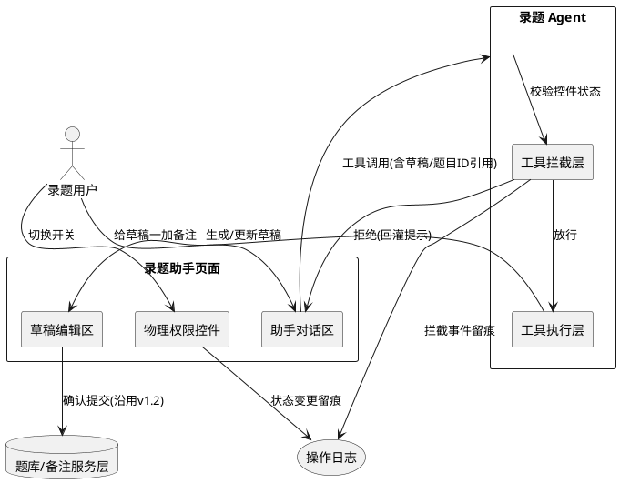
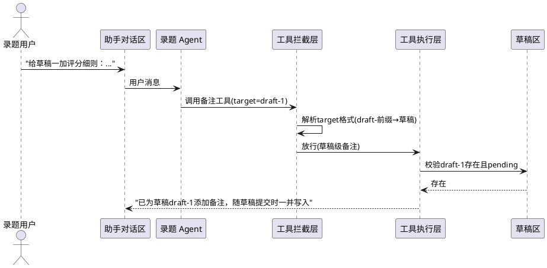
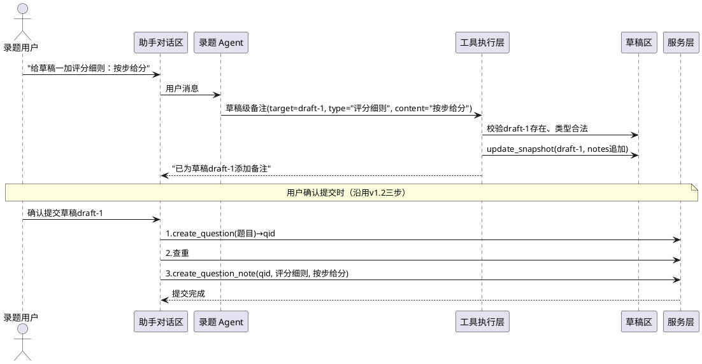

> **版本**：v1.3（增量补充）
> **基线**：基于 `.codeartsdoer/specs/auto_record_agent/spec.md` v1.2
> **修订记录**：
> - v1.3（本次）：针对用户试用反馈补充三项安全与功能增强——
>   1. 草稿编号与题目ID 语义隔离（修复 Agent 把"草稿一"误映射为题目ID 1 的混淆）
>   2. 草稿级备注能力（让 Agent 能给草稿加备注，备注随草稿一并提交，与已有题目级备注区分）
>   3. 物理权限控件（Streamlit UI 开关组控制 Agent 各类写操作，含紧急停止总开关）
> **与基线关系**：本规格不修改 v1.2 已定义的草稿→确认→服务层三段式提交、三层权限校验、撤销栈、操作日志等既有机制，仅在其之上新增/收紧上述三项。凡未提及者，沿用 v1.2。

# **1. 组件定位**

## **1.1 核心职责**
本组件负责在录题 Agent 既有安全机制之上，强化草稿编号与题目ID 的语义隔离、补全草稿级备注能力、新增物理权限控件，使 Agent 在对话侧的能力边界可由用户以 UI 开关即时收放，并消除"草稿一"与"题号1"的引用混淆。

## **1.2 核心输入**
1. 用户在录题助手页面切换物理权限控件开关的操作指令（含紧急停止总开关）
2. 用户在对话中引用"草稿N/草稿一/草稿二"等草稿指代自然语言
3. 用户在对话中引用"题目ID N"等正式题目指代自然语言
4. 用户"给草稿加备注"的对话指令（目标为草稿，非正式题目）
5. Agent 发起的工具调用请求（其参数中可能携带草稿ID引用或题目ID引用）
6. 会话初始化时读取控件默认配置的触发信号

## **1.3 核心输出**
1. 返回给用户的权限拦截提示（"该操作已被禁用"等）
2. 草稿级备注写入草稿快照的 notes 列表（随草稿一并提交，不单独成草稿）
3. 推送给用户的物理控件开关组 UI（含各操作类型开关与紧急停止总开关）
4. 写入操作日志的控件状态变更记录与工具拦截记录（含被拦截工具名、拦截原因、开关状态）
5. 返回给 Agent 的工具执行结果（含草稿ID/题目ID 解析后的明确指代反馈）

## **1.4 职责边界**
本组件不负责：
- 修改草稿→确认→服务层三段式提交的既有流程（草稿级备注仍走"提交草稿→查重→提交备注"三步，复用 v1.2 已实现路径）
- 接管用户管理页面的录题 Agent 授权关系管理（物理控件是会话级即时开关，与用户级授权互补，不替代授权）
- 修改正式题库与备注服务层的写入接口（仅控制 Agent 工具能否生成草稿，不控制服务层）
- 草稿的跨会话持久化（控件状态与草稿均为会话级，会话结束清理，沿用 v1.2）
- Agent 大模型本身的幻觉消除（语义隔离通过工具参数设计与拦截提示缓解，不保证 LLM 100% 不混淆）
- 评分细则匹配流程的权限控制（匹配草稿确认提交沿用 v1.2，本规格的物理控件可覆盖其提交动作但不在本规格详述匹配逻辑）

# **2. 领域术语**

**草稿编号**
: Agent 在单次会话内为草稿分配的序号标识，形如"草稿一/草稿1/draft-1"，指向尚未入库的临时数据，不等于正式题目ID。
: 备注：用户口语中可能说"草稿一""第一份草稿""draft-1"，均属此类。

**题目ID**
: 题库中已正式入库题目的唯一整数标识，由服务层 create_question 写入后生成，可被 get_question_by_id 检索。
: 备注：与草稿编号存在前缀隔离（draft- 前缀 vs 纯整数），二者不得互换引用。

**草稿级备注**
: 附着在 create_question 草稿或 update_question 草稿之上的备注，存储于草稿快照的 notes 列表，在草稿确认提交时随题目一并写入正式题库，不单独成为一份草稿。
: 备注：与"题目级备注草稿"（add_note 草稿，独立成草稿、目标为已存在题目）是两条不同路径。

**题目级备注草稿**
: 通过 add_note_draft 生成的独立草稿，其目标为已正式入库的题目ID，确认提交后单独调用备注服务层写入。沿用 v1.2 定义。

**物理权限控件**
: 录题助手页面上由用户操作的 Streamlit UI 开关集合，按操作类型粒度控制 Agent 工具能否生成对应草稿，是独立于用户授权的会话级即时安全阀。
: 备注：物理指 UI 实体控件（checkbox/toggle），区别于代码内白名单逻辑校验。

**紧急停止总开关**
: 物理权限控件中的最高优先级开关，开启时禁止 Agent 一切写操作（所有生成草稿的工具），仅保留只读与对话能力。

**工具拦截层**
: Agent 工具执行前依据物理权限控件状态对工具调用进行放行或拒绝的校验环节，位于 v1.2 工具白名单校验之后、工具执行函数之前。
: 备注：拦截不抛异常，返回结构化拒绝文本供 Agent 在对话中告知用户。

**默认拒绝**
: 物理权限控件在开关状态不可读或读取异常时，按"禁止该操作"处理的兜底原则。

**操作类型粒度**
: 物理权限控件控制 Agent 能力的划分维度，至少包含：新建题目、修改已有题目、添加备注、插入表格片段、插入题目图片、PDF 多题识别、评分细则匹配七类，外加紧急停止总开关。

# **3. 角色与边界**

## **3.1 核心角色**
- **录题用户**：已通过 v1.2 三层权限校验、具备录题 Agent 使用授权的 editor 及以上角色用户；在本规格中额外操作物理权限控件开关，并接收工具拦截提示。
- **管理员**：admin 角色用户；在本规格中与录题用户共享同一套物理控件（控件为会话级，不按角色区分默认值，沿用 v1.2 授权层级）。

## **3.2 外部系统**
- **DeepSeek API**：当工具被物理控件拦截时，拦截结果以 tool 角色消息回灌给大模型，不发起额外 API 调用。
- **题库服务层 / 备注服务层**：本规格不新增对其调用；物理控件仅控制能否生成草稿，草稿确认提交时调用服务层的既有路径不变。
- **操作日志服务**：控件状态变更与工具拦截事件写入 operation_logs，复用 v1.2 record_log 接口。

## **3.3 交互上下文**


# **4. DFX约束**

## **4.1 性能**
1. 物理权限控件开关切换后，下一次工具调用的拦截判定必须即时生效，控件状态读取耗时不得超过 5 毫秒（控件状态存 session_state，内存读取）。
2. 工具拦截层不得引入额外网络往返；拦截判定为纯内存操作，单次判定耗时不得超过 1 毫秒。
3. 草稿编号与题目ID 的语义解析不得额外调用题库服务层查询（仅依据 ID 字符串格式判断：draft- 前缀为草稿，纯整数为题目）。

## **4.2 可靠性**
1. 物理权限控件状态在单个会话内必须一致，同一开关在同一会话内对同一工具的多次调用给出相同判定（除非用户再次切换）。
2. 控件状态读取异常时按"默认拒绝"处理，不得因读取失败而放行写操作。
3. 草稿级备注随草稿一并提交的事务边界沿用 v1.2（草稿提交与备注写入在同一事务，任一失败回滚），本规格不改变其一致性级别。

## **4.3 安全性**
1. 物理权限控件的开关状态变更必须写入操作日志，含操作人、变更前状态、变更后状态、时间。
2. 工具拦截事件必须写入操作日志，含被拦截工具名、拦截原因（哪个开关关闭）、调用参数预览、时间。
3. 紧急停止总开关的优先级高于所有操作类型粒度开关；总开关开启时，无论各粒度开关状态如何，所有写操作一律拒绝。
4. 物理权限控件不得被 Agent 自身关闭或绕过（控件仅响应用户 UI 操作，Agent 工具无权修改控件状态）。

## **4.4 可维护性**
1. 工具拦截层的拦截规则必须可由配置定义操作类型与工具的映射关系，新增工具时仅需声明其所属操作类型即可纳入控件管辖。
2. 拦截日志需支持按"被拦截工具名""拦截开关"检索，便于事后审计 Agent 越权尝试。

## **4.5 兼容性**
1. 本规格所有增强必须与 v1.2 草稿→确认→服务层三段式兼容：物理控件仅控制草稿生成阶段，不影响用户在草稿编辑区的"确认提交"按钮（确认提交是用户主动动作，不受 Agent 工具控件约束）。
2. 物理权限控件未配置或全部开启时，Agent 行为必须与 v1.2 完全一致（控件是收紧阀，默认全开以保持向后兼容）。
3. 草稿级备注能力不得破坏 v1.2 已有的 add_note 草稿（题目级备注）路径，两条路径并存。

# **5. 核心能力**

## **5.1 草稿编号与题目ID 语义隔离**

### **5.1.1 业务规则**

**功能性需求**

1. **草稿ID格式隔离**：当 Agent 工具参数中出现指向草稿的标识时，该标识必须采用 `draft-N` 前缀格式；当参数中出现指向正式题目的标识时，该标识必须为纯整数。
   a. 验收条件：[Agent 收到"给草稿一加备注"指令] → [工具参数中目标标识为 draft-1，而非整数 1]
   b. 验收条件：[Agent 收到"给题目ID 5 加备注"指令] → [工具参数中目标标识为整数 5]

2. **自然语言草稿指代解析**：当用户在对话中使用"草稿一/草稿1/第一份草稿/draft-1"等指代时，系统应将其解析为对应草稿ID（draft-N），并在工具调用结果中向 Agent 回显明确的草稿ID，避免 Agent 自行推断为整数题号。
   a. 验收条件：[用户说"给草稿二加评分细则"] → [Agent 调用备注工具时目标为 draft-2，工具返回文本含"草稿 draft-2"]
   b. 验收条件：[用户说"给第3份草稿加备注"] → [Agent 目标为 draft-3]

3. **草稿存在性校验**：当 Agent 工具调用以草稿ID 为目标时，系统应校验该草稿ID 在当前会话草稿区存在且为 pending 状态，不存在时返回明确错误。
   a. 验收条件：[Agent 以 draft-99 为目标，但草稿区无此草稿] → [返回"草稿 draft-99 不存在或已提交/丢弃"]

**安全约束性需求**

4. **禁止跨类型引用**：若 Agent 将草稿编号当作题目ID 传入需整数目标的工具参数（或反之），系统应拒绝执行并提示指代类型不匹配。
   a. 验收条件：[Agent 将 draft-1 传入要求整数题目ID 的参数] → [拒绝，提示"draft-1 是草稿ID，不能作为题目ID 使用；若要给草稿加备注请使用草稿级备注能力"]
   b. 验收条件：[Agent 将整数 1 传入要求草稿ID 的参数，但意图是给草稿加备注] → [拒绝，提示"1 是题目ID；若指草稿请用 draft-N 格式"]

5. **回收站题目引用拦截**：当 Agent 以整数题目ID 为目标且该题目处于回收站状态时，系统应拒绝并明确提示，不得静默放行。
   a. 验收条件：[Agent 以题目ID 1 为目标，题目 1 在回收站] → [拒绝，提示"题目ID 1 已在回收站，不可操作"]（沿用 v1.2 既有校验，本规格强调其不得被草稿混淆绕过）

6. **禁止项**：禁止 Agent 在同一工具调用中混合使用草稿ID 与题目ID 作为同一目标参数；禁止系统将"草稿一"自动转换为整数 1 后再按题目ID 查询题库。
   a. 验收条件：[Agent 试图以"草稿一"为单一目标同时既改草稿又改题目] → [拒绝，要求明确单一目标类型]

### **5.1.2 交互流程**


### **5.1.3 异常场景**

1. **草稿指代越界**
   a. 触发条件：用户/Agent 引用的草稿编号超出当前草稿区范围（如只有 2 份草稿却引用草稿三）
   b. 系统行为：工具执行层校验草稿ID 不存在，返回错误文本
   c. 用户感知：对话中显示"草稿 draft-3 不存在，当前草稿区共 2 份（draft-1、draft-2）"

2. **Agent 误将草稿编号当题目ID**
   a. 触发条件：Agent 把"草稿一"映射为整数 1 并传入要求题目ID 的工具参数
   b. 系统行为：工具执行层按题目ID 1 查询题库，若该题在回收站则返回回收站错误；若该题存在则返回"目标为题目ID 1，但用户意图可能是草稿 draft-1，请确认"的消歧提示
   c. 用户感知：对话中显示消歧提示，Agent 应追问用户确认目标类型

3. **草稿已提交/丢弃后被引用**
   a. 触发条件：Agent 以 draft-2 为目标，但 draft-2 已 committed 或 discarded
   b. 系统行为：校验状态非 pending，拒绝
   c. 用户感知："草稿 draft-2 已提交/丢弃，不可再操作"

## **5.2 草稿级备注能力**

### **5.2.1 业务规则**

**功能性需求**

1. **草稿级备注工具可用**：当用户要求给某份草稿（create_question 草稿或 update_question 草稿）加备注时，系统应提供以草稿ID 为目标的备注添加能力，备注追加到该草稿快照的 notes 列表，不单独成为一份草稿。
   a. 验收条件：[用户说"给草稿一加评分细则：按步给分"] → [草稿 draft-1 的 snapshot.notes 新增一条 {type_name:"评分细则", content:"按步给分"}，草稿区不新增独立草稿]
   b. 验收条件：[草稿区草稿数 = N，给草稿加备注后] → [草稿数仍为 N，不变为 N+1]

2. **备注随草稿一并提交**：当用户确认提交携带 notes 的草稿时，系统应先提交题目（create_question 或 update_question），再逐条提交 notes 中的备注（create_question_note），沿用 v1.2 已实现的三步流程。
   a. 验收条件：[草稿 draft-1 携带 2 条备注，用户点确认提交] → [题目入库得 qid，随后 2 条备注以 qid 为目标写入，返回"已提交，备注2条"]
   b. 验收条件：[草稿携带 0 条备注] → [仅提交题目，备注提交步骤跳过，沿用 v1.2]

3. **草稿级备注类型校验**：当 Agent 添加草稿级备注时，备注类型必须匹配备注类型表已有类型，不得编造新类型（沿用 v1.2 对 add_note_draft 的约束）。
   a. 验收条件：[Agent 以 type_name="评分细则"给草稿加备注] → [通过，"评分细则"为已有类型]
   b. 验收条件：[Agent 以 type_name="新发明的类型"给草稿加备注] → [拒绝，提示使用已有类型]

4. **草稿级备注可多次追加与删除**：当用户在草稿确认提交前，系统应支持对同一草稿的 notes 列表多次追加与单条删除（页面侧已有 UI，本规格要求 Agent 侧也能触发追加）。
   a. 验收条件：[草稿 draft-1 已有 1 条备注，Agent 再加 1 条] → [notes 列表变为 2 条]
   b. 验收条件：[用户在草稿编辑区删除第 1 条备注] → [notes 列表变为 1 条，删除第 1 条]（沿用 v1.2 页面 UI）

**安全约束性需求**

5. **草稿级备注不直接写库**：当 Agent 调用草稿级备注能力时，系统仅修改草稿快照的 notes 列表，不得直接调用备注服务层 create_question_note；写库仅发生在用户确认提交草稿时。
   a. 验收条件：[Agent 给草稿加备注] → [仅 draft_store.update_snapshot 修改 notes，不调用 create_question_note]
   b. 验收条件：[用户确认提交草稿] → [此时才调用 create_question_note]（沿用 v1.2 _commit_draft）

6. **草稿级备注与题目级备注路径隔离**：草稿级备注（目标为草稿ID）与题目级备注草稿（目标为已存在题目ID，独立成草稿）是两条并存路径，系统不得将草稿级备注误转为指向回收站题目的题目级备注草稿。
   a. 验收条件：[用户给草稿 draft-1 加备注] → [走草稿级备注路径，notes 追加到 draft-1 快照]
   b. 验收条件：[用户给题目ID 5 加备注] → [走题目级备注路径，生成独立 add_note 草稿，目标为 5]（沿用 v1.2）

7. **禁止项**：禁止草稿级备注目标指向 add_note 类型草稿（备注草稿不再叠加备注）；禁止草稿级备注绕过类型校验直接写入 notes 列表。
   a. 验收条件：[Agent 试图给一份 add_note 草稿加草稿级备注] → [拒绝，提示"备注草稿不能再叠加备注"]

### **5.2.2 交互流程**


### **5.2.3 异常场景**

1. **草稿级备注目标草稿不存在**
   a. 触发条件：Agent 以 draft-3 为目标加备注，但草稿区无 draft-3
   b. 系统行为：校验失败，返回错误
   c. 用户感知："草稿 draft-3 不存在，无法添加备注"

2. **草稿级备注类型不存在**
   a. 触发条件：Agent 使用的 type_name 不在备注类型表
   b. 系统行为：拒绝，返回可用类型提示
   c. 用户感知："备注类型'XX'不存在，不可编造新类型"

3. **草稿级备注内容为空**
   a. 触发条件：Agent 传入空 content
   b. 系统行为：拒绝，提示内容必填
   c. 用户感知："备注内容不能为空"

4. **提交时备注写入部分失败**
   a. 触发条件：草稿携带 3 条备注，提交时第 2 条 create_question_note 抛异常
   b. 系统行为：沿用 v1.2 _commit_draft 既有容错（单条失败不阻塞其余，计数返回）
   c. 用户感知："已提交，备注2条"（成功 2 条，失败 1 条，沿用 v1.2 行为）

## **5.3 物理权限控件**

### **5.3.1 业务规则**

**功能性需求**

1. **控件组呈现**：当录题用户进入录题助手页面时，系统应在页面显著位置（顶部或侧边栏）呈现一组物理权限控件开关，至少包含：新建题目、修改已有题目、添加备注、插入表格片段、插入题目图片、PDF 多题识别、评分细则匹配七类操作开关，以及一个紧急停止总开关。
   a. 验收条件：[用户打开录题助手页面] → [可见上述 8 个开关（7 粒度 + 1 总开关）]
   b. 验收条件：[每个开关有清晰的操作类型标签与当前开/关状态指示]

2. **控件默认全开**：当会话首次初始化物理权限控件时，所有粒度开关与紧急停止总开关默认为"允许"（开启写能力）状态，以保持与 v1.2 行为一致。
   a. 验收条件：[新会话首次进入页面] → [所有开关均为允许状态，Agent 行为与 v1.2 一致]

3. **控件状态会话内持久**：当用户切换某开关后，该状态在当前会话内持续生效，直至用户再次切换或会话结束。
   a. 验收条件：[用户关闭"修改已有题目"开关，进行多次对话] → [整个会话内 update_question_draft 工具均被拦截]
   b. 验收条件：[用户重新打开该开关] → [后续 update_question_draft 工具恢复放行]

4. **拦截反馈**：当 Agent 调用的工具所属操作类型对应开关被关闭时，系统应拒绝执行该工具，并在对话中向用户与 Agent 提示"该操作已被禁用"及具体被关闭的开关名。
   a. 验收条件：["添加备注"开关关闭，Agent 调用备注工具] → [工具被拦截，对话显示"添加备注操作已被禁用，请在权限控件中开启"]
   b. 验收条件：[拦截后 Agent 收到 tool 角色拒绝消息] → [Agent 应停止重试该工具，转而告知用户开启开关]

5. **控件状态变更留痕**：当用户切换任一开关时，系统应写入操作日志，记录操作人、开关名、变更前状态、变更后状态、时间。
   a. 验收条件：[用户关闭"新建题目"开关] → [operation_logs 新增一条 action=permission_toggle，含开关名与前后状态]

**安全约束性需求**

6. **紧急停止总开关最高优先级**：当紧急停止总开关开启（停止状态）时，无论各粒度开关状态如何，所有生成草稿的写操作工具一律拒绝；只读工具（如 pdf_preview_fragment）与纯对话能力不受影响。
   a. 验收条件：[总开关停止，"新建题目"开关仍允许] → [create_question_draft 仍被拒绝]
   b. 验收条件：[总开关停止] → [pdf_preview_fragment 等只读工具正常执行，Agent 可对话]

7. **默认拒绝**：当控件状态读取异常（session_state 缺失或损坏）时，系统应按"禁止该操作"处理，不得因读取失败放行写操作。
   a. 验收条件：[控件状态读取抛异常] → [写操作工具被拒绝，提示"权限状态异常，已默认拒绝"]

8. **控件不可被 Agent 绕过**：当 Agent 试图通过任何工具调用修改控件状态时，系统应拒绝；控件仅响应用户在 UI 上的直接操作。
   a. 验收条件：[Agent 调用任何工具试图开启某开关] → [拒绝，Agent 工具集中无修改控件的能力]

9. **确认提交不受 Agent 工具控件约束**：当用户在草稿编辑区点击"确认提交"按钮时，该动作是用户主动行为，不受物理权限控件约束（控件仅控制 Agent 生成草稿阶段）。
   a. 验收条件：["新建题目"开关关闭，但草稿区已有 create_question 草稿] → [用户仍可点"确认提交"将该草稿入库]
   b. 验收条件：[紧急停止总开关开启] → [用户确认提交既有草稿仍可用]（总开关仅停止 Agent 新生成草稿，不阻止用户提交已有草稿）

10. **禁止项**：禁止物理控件控制用户在草稿编辑区的手动编辑与确认提交（那是用户直接操作，非 Agent 工具调用）；禁止控件状态跨会话持久（会话结束清理，下次会话恢复默认全开）。
    a. 验收条件：[会话 A 关闭某开关，会话 B 新开] → [会话 B 该开关为默认允许]

### **5.3.2 交互流程**
```plantuml
@startuml
actor "录题用户" as U
participant "物理权限控件" as Ctrl
participant "助手对话区" as Chat
participant "录题 Agent" as Agent
participant "工具拦截层" as Guard
participant "工具执行层" as Tool
storage "操作日志" as Log

U -> Ctrl : 关闭"修改已有题目"开关
Ctrl -> Log : 记录状态变更
Ctrl --> U : 开关已关闭

U -> Chat : "把题目5的答案改成XX"
Chat -> Agent : 用户消息
Agent -> Guard : 调用update_question_draft(target=5)
Guard -> Ctrl : 读取"修改已有题目"开关状态
Ctrl --> Guard : 关闭
Guard -> Log : 记录拦截事件
Guard --> Chat : "修改已有题目操作已被禁用，请在权限控件中开启"
Chat --> U : 显示拦截提示
@enduml
```

### **5.3.3 异常场景**

1. **控件状态读取异常**
   a. 触发条件：session_state 中控件状态缺失或类型损坏
   b. 系统行为：按默认拒绝处理写操作，只读工具放行
   c. 用户感知：写操作被拒，提示"权限状态异常，已默认拒绝，请刷新页面重试"

2. **Agent 反复重试被拦截工具**
   a. 触发条件：某工具被拦截后，Agent 在后续轮次再次调用同一工具
   b. 系统行为：每次均拦截并返回拒绝文本；沿用 v1.2 工具调用预算与去重机制（相同签名第二次跳过）
   c. 用户感知：对话中重复出现拦截提示，Agent 应转为告知用户开启开关而非无限重试

3. **紧急停止后用户仍想提交已有草稿**
   a. 触发条件：紧急停止总开关开启，草稿区有已生成草稿待确认
   b. 系统行为：用户确认提交按钮可用（控件不约束用户主动提交），提交走 v1.2 既有路径
   c. 用户感知：可正常提交已有草稿，但 Agent 无法再生成新草稿

4. **开关切换与工具调用并发**
   a. 触发条件：用户切换开关的同时 Agent 正在执行一次工具调用
   b. 系统行为：以工具进入拦截层那一刻的开关状态为准判定，切换对下一次调用生效
   c. 用户感知：无中间态错误，单次调用结果一致

# **6. 数据约束**

## **6.1 草稿ID 引用**
1. **标识格式**：草稿ID 必须为 `draft-` 前缀加正整数序号（如 draft-1），题目ID 必须为纯正整数，二者格式互斥。
2. **引用唯一性**：草稿ID 在单个会话内唯一，会话间不保证唯一；题目ID 全局唯一。
3. **可解析性**：草稿ID 可由 `draft-` 前缀判定为草稿引用，无需查询题库；题目ID 由纯整数判定，需查询题库确认存在。

## **6.2 草稿级备注（snapshot.notes 列表元素）**
1. **type_id**：必须为备注类型表已有类型 ID，非空。
2. **type_name**：必须与 type_id 对应的备注类型名一致，非空。
3. **content**：备注正文（Markdown），非空字符串。
4. **追加顺序**：按 Agent/用户追加时间顺序排列，提交时按列表顺序逐条写入。
5. **所属草稿类型限制**：仅 create_question 草稿与 update_question 草稿可携带 notes；add_note 草稿不得携带 notes。

## **6.3 物理权限控件状态**
1. **粒度开关集合**：至少 7 个操作类型开关，每个开关取值为"允许"或"禁止"二态。
2. **紧急停止总开关**：独立二态开关，取值"正常"或"停止"。
3. **会话隔离**：控件状态按 session_id 隔离存储，会话结束清理。
4. **默认值**：所有开关默认为"允许/正常"（全开，兼容 v1.2）。
5. **变更可追溯**：每次状态变更对应一条 operation_logs 记录，含变更前后值。
6. **不可被工具修改**：控件状态仅由用户 UI 操作变更，Agent 工具集中无修改控件状态的工具。

## **6.4 工具拦截记录（operation_logs 增量字段）**
1. **action**：取值 `permission_toggle`（控件变更）或 `permission_denied`（工具拦截，沿用 v1.2 已有 action，detail 扩展）。
2. **detail.layer**：拦截层标识，取值 `tool_guard`（物理控件拦截层），与 v1.2 的 `page`/`api`/`tool` 区分。
3. **detail.reason**：拦截原因，取值 `switch_off`（粒度开关关闭）或 `emergency_stop`（总开关停止）或 `default_deny`（状态异常默认拒绝）。
4. **detail.switch_name**：被关闭的开关名（粒度拦截时必填）。
5. **detail.tool**：被拦截的工具名（工具拦截时必填）。
